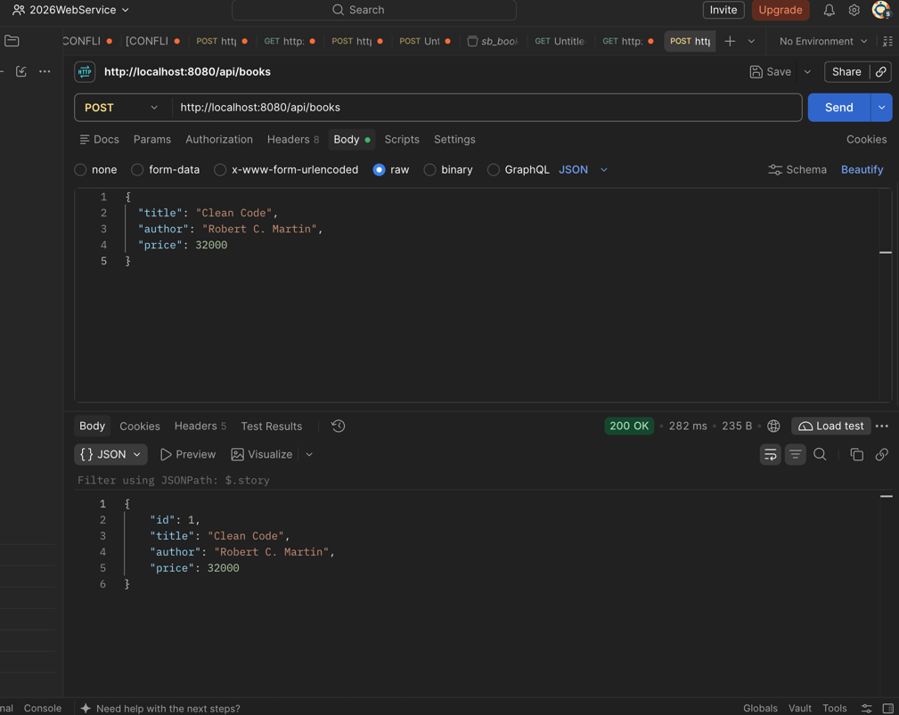
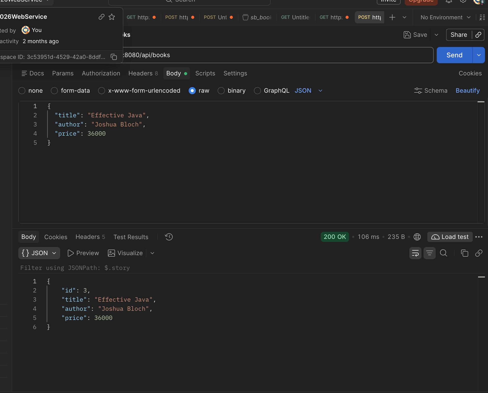

# Week 12 Sample Project - Book REST API (학생용 Starter)

기본 CRUD가 구현되어 있습니다. **해답 코드 (DTO/Validation/Exception/Pagination/Swagger)는 제공되지 않습니다.**

## 실행

- Java 17 필요
- Gradle 8.x 설치 후 `gradle bootRun` (프로젝트에는 공식 Gradle Wrapper 바이너리가 포함되지 않았습니다.)
- 기본값은 학습 편의상 메모리 H2 DB입니다. 재시작 시 데이터가 초기화됩니다.
- MariaDB 실습: `docker compose up -d` 후 아래 환경 변수를 설정하여 실행하세요.
    - `SPRING_PROFILES_ACTIVE=mariadb`
    - `DB_URL=jdbc:mariadb://localhost:3307/week12`
    - `DB_USERNAME=week12`, `DB_PASSWORD=week12_local_only`
    - 처음 DB 생성 시에만 `DDL_AUTO=update` (이후 `validate` 권장)
- **Render 배포**에서는 DB_URL/DB_USERNAME/DB_PASSWORD와 `SPRING_PROFILES_ACTIVE=mariadb`, `DDL_AUTO=validate`를 설정하고, 외부
  MariaDB 접근을 사전에 확인하세요.

## API

- GET `/api/books`, GET `/api/books/{id}`
- POST `/api/books`, PUT `/api/books/{id}`, DELETE `/api/books/{id}`

```bash
curl http://localhost:8080/api/books
curl -X POST http://localhost:8080/api/books -H 'Content-Type: application/json' -d '{"title":"Clean Code","author":"Martin","price":35000}'
```

## TODO (STEP 3~7)

1. `BookRequest`, `BookResponse` DTO 만들기
2. Controller와 Service의 요청/응답을 DTO 중심으로 개선하고 `ResponseEntity` 사용
3. Bean Validation 적용
4. 전역 예외 처리: 400/404 구조 통일
5. `Pageable` / `Sort` 구현 (`GET /api/books?page=0&size=5&sort=price,desc`)
6. Swagger UI / OpenAPI 문서화

> 테스트 결과는 `results/`에 저장하고 README에 자기 말로 분석 결과를 기록하세요.

### Project Structure & JPA

1. BookController, BookService, BookRepository의 역할과 요청 처리 흐름을 설명하세요.

- BookController (list (), get (), create (), update (), delete ()) -> /api/books HTTP 요청 받기 ->  DTO로 변환된 데이터를 주고 받기
- BookService (findAll (), findById (), create (), update (), delete ()) -> DTO <-> Entity 변환을 처리, BookRepository를 호출하기
- BookRepository : JpaRepository<Book, Long> 상속받기 -> 실제 MariaDB에 SQL 쿼리 실행하기

2. JpaRepository<Book, Long>만 선언해도 findAll (), save ()를 사용할 수 있는 이유를 설명하세요.

- Spring Data JPA가 BookRepository 인터페이스를 분석 -> 빈을 자동으로 생성해주기 때문
- SimpleJpaRepository에 findAll (), save (), findById (), deleteById () 등은 이미 구현되어 있기 때문

### DTO & HTTP Response

3. 기존 API가 Book Entity를 직접 요청·응답에 사용할 때 발생할 수 있는 문제를 설명하세요.

- 클라이언트가 요청 JSON에 id 값을 임의로 넣어 보낸다면 서버가 생성해야할 것들에 수정이 일어날 수 있음
- Book 엔티티 필드가 바뀌면 API 응답이 강제로 변경됨
- 민감하거나 불필요한 내용이 외부에 그대로 노출되는 문제가 생길 수 있음

4. Request DTO와 Response DTO를 분리하는 이유와 ResponseEntity가 필요한 상황을 설명하세요.

- BookRequest는 (title, author, price)만 받고 id를 차단하고, BookResponse는 클라이언트에 보여줄 응답 데이터만 안전하게 전달하기 위해 분리하기
- ResponseEntity는 200 OK 외에 생성 성공 시 201 Created, 오류 시 400/404 상태 코드와 헤더를 명확하게 제어하기 위해 필요함

### Validation & Exception Handling

5. @Valid, @NotBlank, @Min은 각각 어느 시점에 어떤 동작을 수행하나요?

- @Valid: BookController의 create (), update () 메서드가 실행되기 전, 클라이언트가 보낸 JSON이 BookRequest 객체로 변환될 때 유효성 검증을 시작하게 함.
- @NotBlank: BookRequest의 title과 author 필드가 null이거나, 빈 문자열 ("")이나 공백 (" ")만 있는지 확인함.
- @Min (0): BookRequest의 price 값이 지정된 최솟값 (0)보다 작은 음수인지 검사함.

6. @RestControllerAdvice와 @ExceptionHandler를 사용하면 예외 처리 흐름이 어떻게 바뀌나요?

- @RestControllerAdvice를 사용하면 모든 @RestController에서 발생하는 예외를 한 곳에서 파악하고,
- @ExceptionHandler가 예외 타입에 맞춰 JSON 오류 응답 (400, 404)을 반환하도록 흐름이 바뀐다.

### Pagination & OpenAPI

7. Pageable과 Page<T>는 각각 어떤 역할을 하며 sort=price,desc는 어떻게 처리되나요?

- Pageable: URL 쿼리 파라미터 (page, size, sort)로 클라이언트가 페이지 번호, 한 페이지당 데이터 개수, 정렬 기준 정보를 보내면 스프링이 자동으로 담아서
  BookController.list ()와 BookService.findAll ()로 전달해 주는 인터페이스다.
- Page<T>: BookRepository.findAll (pageable) 실행 결과로 조회된 현재 페이지의 content와 함께 totalElements, totalPages 등 페이징 메타데이터를 함께 담아
  반환하는 객체다.
- sort=price,desc 처리: Spring Data JPA가 Pageable 안의 정렬 정보를 해석 -> DB 쿼리 실행 시 ORDER BY price DESC SQL 절을 자동으로 생성 -> 내림차순으로
  정렬된 가격 결과를 가져온다.

8. /v3/api-docs와 /swagger-ui.html의 역할을 구분해서 설명하세요.

- /v3/api-docs: springdoc-openapi가 컨트롤러와 DTO, @Tag, @Operation 어노테이션을 분석 -> 전체 REST API 경로와 상태코드를 기계가 읽을 수 있는 JSON 형식으로
  제공함
- /swagger-ui.html: /v3/api-docs의 JSON 데이터를 불러와서 개발자나 사용자가 브라우저에서 API 목록을 확인하고 직접 요청을 보내 테스트할 수 있도록 보여주는 웹 UI 화면이다.

### Refactoring: DTO와 ResponseEntity 변경 전/후 비교

- 요청 데이터 (`POST`, `PUT`)
    - 변경 전: `Book` Entity를 그대로 받아서 요청 JSON에 `id`까지 들어갈 수 있었음
    - 변경 후: `BookRequest` DTO로 분리해서 `title`, `author`, `price`만 입력받도록 수정

- 응답 데이터 (`GET`, `POST`, `PUT`)
    - 변경 전: DB와 연결된 `Book` Entity를 그대로 응답으로 반환
    - 변경 후: `BookResponse` DTO (`BookResponse.from()`)로 변환해서 필요한 필드만 응답

- HTTP 상태 코드 (`ResponseEntity` 적용)
    - 변경 전: 생성 (`POST`)이랑 삭제 (`DELETE`) 모두 그냥 `200 OK`로 반환됨
    - 변경 후: `POST` 성공 시 `201 Created`, `GET`/`PUT` 성공 시 `200 OK`, `DELETE` 성공 시 `204 No Content`를 반환하도록 변경

### 1) 초기 Sample CRUD 테스트



### 2) DTO 적용 후 POST 성공 (201 Created)



AI 활용
7,8번 문제 답변을 몰라서 사용한 후 이해한 내용을 바탕으로 정리하여 리드미에 작성함.

